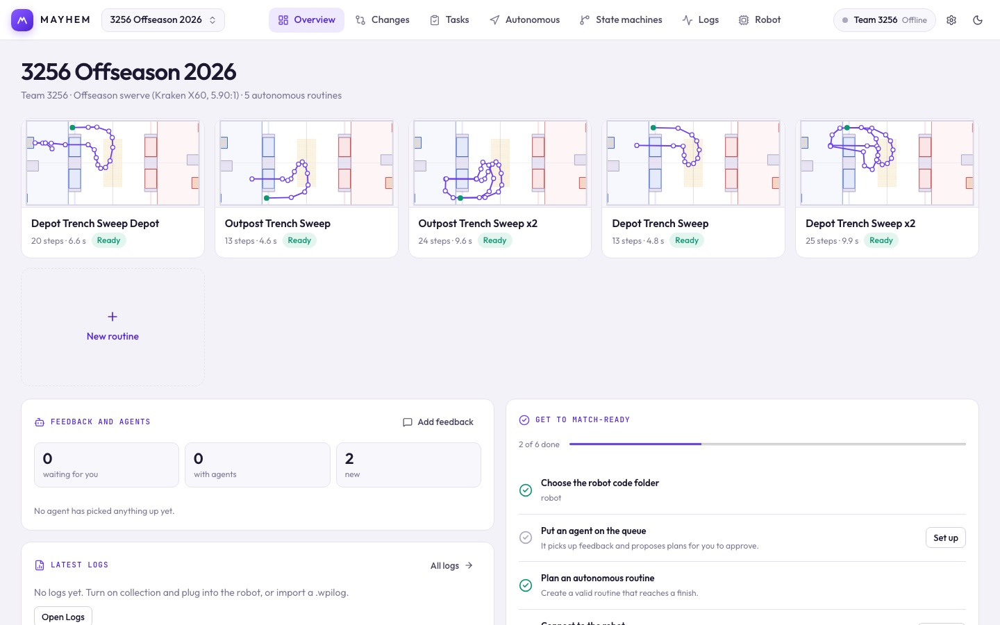

# Introduction

Mayhem is one desktop app for a robot's software. You build pose-based autos, watch state machines run, analyze match logs, see what code is on the robot, review what a code change actually does, and turn team feedback into tasks for coding agents.

## How the pieces fit

Mayhem works on the robot code repository you already have. It doesn't replace your code; it reads it and adds a few files next to it.

| Piece | Where it lives | What it does |
| --- | --- | --- |
| **The desktop app** | Your laptop | Every workspace in this guide. |
| **`robot.mayhem.json`** | Root of the robot repo | The project: robot limits, autonomous routines and state machines. The app edits it; agents can too. |
| **`tools/mayhem/`** | Robot repo | Driver-control machines, sim proof scenarios, team tasks and the robot explainer. See [the tools/mayhem folder](/reference/repo-files). |
| **The C++ library** | Robot code (`MayhemCpp` vendordep) | Runs the exported routines and state machines on the robot. See [Robot code](/robot-code/setup). |
| **`MayhemProject.h`** | Robot code, generated | Your routines and machines as C++, exported from the project. |
| **Agents (optional)** | Your laptop | Coding agents pick up tasks, propose a plan you approve, and change the code. See [Agents](/agents/). |

## Choose your path

| You want to | Start here |
| --- | --- |
| Install the app | [Installation](/guide/installation) |
| Build and preview an auto | [Your first auto](/guide/quick-start) |
| See how a team uses it week to week | [A week with Mayhem](/guide/workflow) |
| Find your way around the app | [The app at a glance](/suite/overview) |
| Get autos and state machines running on the robot | [Set up a robot repo](/robot-code/setup) |
| Review a robot code change | [Changes](/suite/changes) |
| Hand work to coding agents | [Connect an agent](/agents/) |
| Work on Mayhem itself | [Building and contributing](/reference/building) |

## The workspaces

- **[Overview](/suite/overview):** routine thumbnails, latest logs, the match-ready checklist and a clickable map of how the robot works.
- **[Changes](/suite/changes):** what a code change does to controls, state machines, values, hardware and autos, with a before/after sim proof.
- **[Tasks](/suite/tasks):** feedback, pit notes and driver forms become agent tasks; approve plans and check changes.
- **[Autonomous](/suite/autonomous):** place goals, add actions and conditions, preview the path or the full routine.
- **[State machines](/suite/state-machines):** graphs in simulation, live over NT4, or replayed from a log.
- **[Logs](/suite/logs):** findings, power, signals and pose replay for every recording.
- **[Robot](/suite/robot):** what's on the robot now, every value in the code, specs, connection and log collection.

::: warning What the preview doesn't prove
The auto preview is kinematic. It doesn't run your custom robot code, model traction or avoid obstacles, and the pose controller still has to be tuned on the real robot. See the [implementation status](https://github.com/ryanabraham1/Mayhem/blob/main/docs/SUITE_STATUS.md) for what's been verified.
:::
