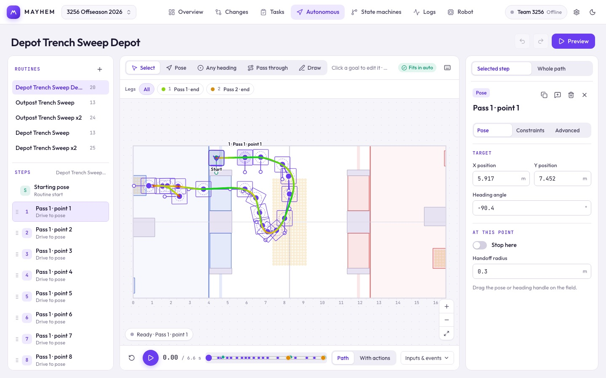

# Your first auto

This walks through building an auto, previewing it, and getting it into robot code. It takes about ten minutes. You don't need a robot; you do need the [desktop app](/guide/installation).

## 1. Open your robot code

On **Overview**, click **Choose robot code folder** and pick your robot repository. If it has a `robot.mayhem.json`, Mayhem opens that project, linked to the file, so your edits save straight into the repo.

No project yet? Click the project name in the top bar and create one, then save it into the repo later with **Tasks → Connect an agent → Save project file**.

## 2. Tell Mayhem about the robot

On **Robot → Specs & limits**, enter the robot's length, width and drive limits (max speed, acceleration, turn speed). Every auto is planned with them, so use real numbers.

Add the **typed inputs** your auto will wait on, such as "has a game piece" or "shooter ready". They become conditions in the routine and signals your robot code provides.

## 3. Place goals



Open **Autonomous** and create a routine. Drag the starting robot into place, then pick a tool above the field and click to place goals:

- **Pose** (`W`): the robot gets to this point at this heading.
- **Any heading** (`T`): the robot gets here, whatever way it's facing.
- **Pass through** (`G`): the robot drives through without stopping.
- **Draw** (`D`): drag a route freehand; it becomes a few pass-through points and a final pose.

Drag a goal's knob to turn it. Select a step to set **Stop here**, its speed limits, and under **Advanced** the actions, conditions and watchdog timeouts.

## 4. Add what the robot does

Right-click a step and choose **Add action after**. Give the action an ID like `intake.acquire`; your robot code will bind that ID to real code. Add a transition condition such as `pieceDetected` so the routine waits for the sensor instead of a timer.

## 5. Preview it

Press **Preview** (Space). **Path** drives the route. **With actions** runs the routine like the robot will, waiting on the inputs and action results you set under **Inputs & events**. Check that the badge above the field says **Fits in auto**.

Open **Whole path → Map → Generate** to let Mayhem choose speed caps and corner radii for each segment.

## 6. Put it on the robot

Generate the C++ header from the project:

```sh
node scripts/mayhem.mjs cpp robot.mayhem.json --out src/main/include/MayhemProject.h
```

Then bind your action and signal IDs on the runner and start it in autonomous. [Running autos](/robot-code/autos) shows the whole robot side, including red-alliance flipping.

## Next

- [Everything in Autonomous](/suite/autonomous)
- [A week with Mayhem](/guide/workflow): how autos, logs, reviews and agents fit together across a build week.
