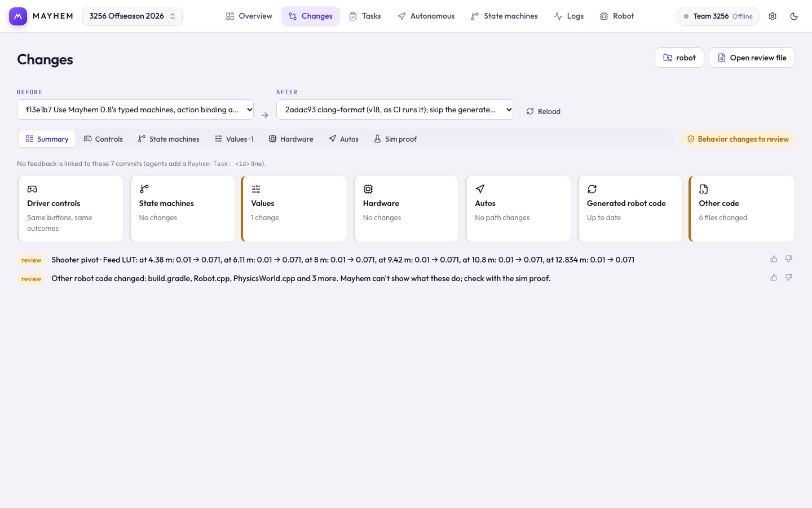

# A week with Mayhem

Each workspace is useful alone, but they're built to work as a loop: drive the robot, collect logs, tell an agent (or a person) what's wrong, review the change by what it does, and deploy. This page follows that loop.

## Before the robot drives

- **Pick the robot code folder** once, on any page. Changes, Robot and the Overview all read it.
- **Turn on log collection** in **Robot → Log collection**. Mayhem pulls new `.wpilog` files off the roboRIO whenever the laptop is on the robot network. See [Log collection](/suite/robot#log-collection).
- **Connect** with your team number in **Robot → Connection** to see live state machines and the robot's current state. Mayhem only reads NetworkTables; it never commands the robot.
- Work through **Overview → Get to match-ready**. Each item has a button that takes you to the fix.

## After a practice match

1. The log arrives in **[Logs](/suite/logs)** and is checked right away: brownouts, battery sag, loop overruns, disconnects and flickering signals.
2. **Robot → On the robot now** shows which commit is running, whether it was deployed with uncommitted changes, and how it differs from `main`.

## Fixing it

Tell your coding agent what you saw, in its chat: the match, the log, the moment, what the robot did and what it should have done. The agent works on a branch and commits. When it says the change is ready, the branch is already waiting in Mayhem: the **Changes** tab shows a count, and the Overview lists it with its risk and whether a sim proof was run on it.

A teammate's branch shows up the same way; Mayhem doesn't care who wrote it.

## Reviewing the change

Pick the branch under **To review** in **[Changes](/suite/changes)**. Mayhem compares it with the commit where it left `main`, by behavior: driver controls, state machines, values, hardware, autos, and any other code that changed. A red chip means a safety change, such as a CAN ID, current limit, motor direction or gear ratio. The **sim proof** line shows the run recorded on that exact commit, or lets you run it: both versions built, every button pressed, every auto and your team's scenarios run, any difference replayable.

If it's right, merge the branch. If it isn't, tell the agent what's wrong in the chat. After the merge the branch moves to **Merged**, and Mayhem shows when it is on the robot and when a log recorded on it comes back.

## At competition

- Keep `main` as the known-good version. If the robot is running something else and it misbehaves, **Robot → On the robot now → Put main back on the robot** builds and deploys `main` (robot connected and disabled).
- Upload logs to the team site from **Robot → Log collection → Team upload** so the whole team can open them.
