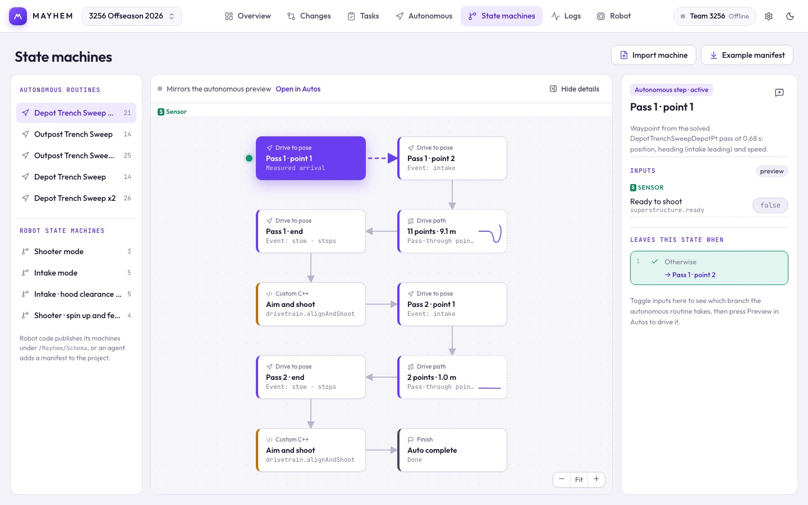

# State machines

Describe each mechanism's states and transitions once, in `tools/mayhem/machines.json`. From that one description you get a typed C++ machine for the robot, a graph you can simulate and watch live, a driver-controls table on the Changes page, and button tests in the sim proof.



## Write a machine spec

```json
{
  "machines": [
    {
      "id": "IntakeMode",
      "name": "Intake mode",
      "initial": "STOWED",
      "stateChannel": "/RealOutputs/Superstructure/IntakeMode",
      "inputs": {
        "operator": {
          "intakePressed": { "name": "X pressed (intake on / off)", "event": true },
          "jitterHeld": "Y held (jitter)"
        },
        "internal": { "enabled": "Robot enabled" },
        "sensor": { "distance": { "name": "Shot distance", "type": "number", "unit": "m" } }
      },
      "states": {
        "STOWED": "Stowed",
        "INTAKING": { "name": "Intaking", "description": "Slide out, rollers in." },
        "JITTERING": "Jittering"
      },
      "transitions": [
        "* -> STOWED: !enabled  # Disabled",
        "STOWED -> INTAKING: enabled && intakePressed  # X",
        "INTAKING -> STOWED: intakePressed  # X",
        "INTAKING -> JITTERING: jitterHeld && distance < 2.5",
        "JITTERING -> INTAKING: !jitterHeld  # Y released"
      ]
    }
  ]
}
```

- **Inputs** are grouped by category: `operator` (driver buttons), `sensor` (measured), `internal` (computed in code), `timer`, `auto`. Operator inputs are what the Changes page calls **driver controls**, so name them after the button.
- `"event": true` marks a one-loop press, so a single X press can't toggle twice in one loop.
- **Transitions** are in priority order: `FROM -> TO: condition  # label`. `*` means from any state; `* except A, B -> TO` leaves some out.
- Conditions use input names with `&&`, `||`, `!`, comparisons and parentheses. `stateTime` (seconds in the current state) is built in.
- For a supervisor that picks a state from requests every loop, add `"selection": "priority"` and end with an `always` row. The app draws it as a decision ladder.

Apply the spec to the project (it validates first, and writes nothing if anything's wrong):

```sh
node scripts/mayhem.mjs machine apply robot.mayhem.json tools/mayhem/machines.json
```

Then regenerate `MayhemProject.h`. `machine spec robot.mayhem.json IntakeMode` prints an existing machine back as a spec to edit.

## Run it on the robot

The generated header has a typed machine per spec. A misspelled input or state is a compile error:

```cpp
#include "MayhemProject.h"

mayhem_generated::IntakeMode::Machine intake;
using Intake = mayhem_generated::IntakeMode::State;

// Startup: the clock times stateTime; InputLogging::On logs every input for replay.
mayhem::WpiLogObserver intakeLog{frc::DataLogManager::GetLog(), "IntakeMode"};
intake.Attach(intakeLog, [] { return frc::Timer::GetFPGATimestamp().value(); }, mayhem::InputLogging::On);

// Every loop:
auto& in = intake.In();
in.enabled = frc::DriverStation::IsEnabled();
in.intakePressed = controller.GetXButtonPressed();
in.jitterHeld = controller.GetYButton();
intake.Settle();
if (intake.Is(Intake::INTAKING)) rollers.SetVoltage(8_V);
```

The machine only decides the state. Your code reads it and drives the motors, and owns disabled handling.

`Settle()` takes transitions until nothing else fires in this loop (at most 8). Use `Tick()` for a single step per loop.

## Machines you already have

You don't have to rewrite working code. A manifest can describe an existing state machine: point `stateChannel` and each input's `channel` at the channels you already log, and the app will show it live and in log replay. Robot code can also publish a manifest at `/Mayhem/Schema/<machine>`.

## Make the graph readable

- Give transitions a short `# label` ("Hood clear", "X"); otherwise the graph shows the whole condition.
- Name inputs after what a driver presses: "Home requested (B)".
- Give states a `description`. It appears on the robot explainer and in the inspector.
