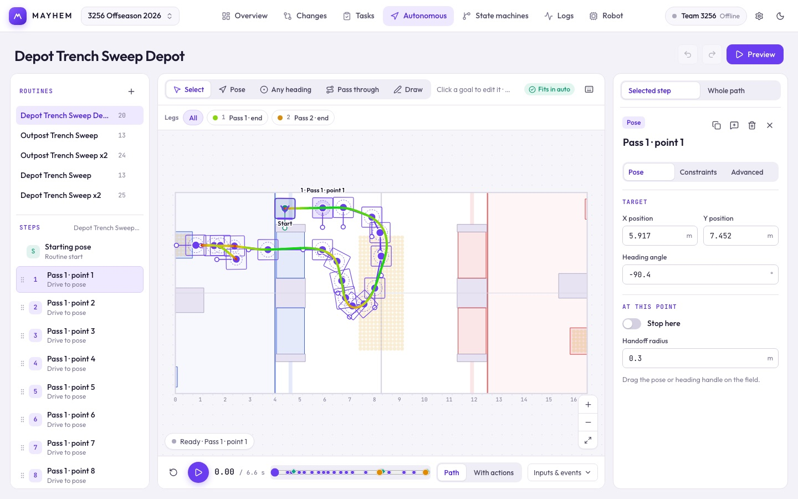

# Autonomous

Build an auto by placing goals on the field, attach actions and conditions, then preview it.

The header shows the step count and how much of the 15 s auto period the routine uses; the badge above the field says **Fits in auto**, how far over it is, **Doesn't finish**, or how many errors to fix.

Set the robot's size and limits on [Robot → Specs & limits](/suite/robot#specs-limits) first; every routine is planned with them. Field coordinates use the blue-alliance origin.

## Routines

The left rail lists routines. Right-click one to open, rename, duplicate, delete or create a routine. Below it, the selected routine's steps appear in order:

- **Starting pose.** Drag the robot and its heading handle on the field, or right-click → **Edit starting pose**. **Use robot default start** clears it.
- **Steps.** Drag to reorder, or right-click for **Move up / down / to top**, **Duplicate**, **Add pose goal after**, **Add action after**, **Add custom C++ after** and **Delete step**.

## Placing goals

Pick a tool above the field:

| Tool | Key | Places |
| --- | --- | --- |
| **Select** | `V` / `Esc` | Nothing: click to select, drag to move. Double-click the field to add a pose. |
| **Pose** | `W` | A goal with a fixed heading. The robot settles there. |
| **Any heading** | `T` | A goal the robot reaches at whatever heading. |
| **Pass through** | `G` | A point the robot drives through without stopping. |
| **Draw** | `D` | Drag a route freehand; it becomes a few pass-through points and a final pose after the selected step. Hold Shift on release to keep the heading. |

Drag a goal's knob to turn it; Shift-drag snaps to 15°. Right-click a goal to turn, duplicate or delete it. When goals are stacked, click the stack to spread them out.

Routines with several legs show a strip above the field. Click a leg to focus it; the path is colored by speed.

## The inspector

The right panel has two tabs. Hide it with its close button and bring it back with **Show inspector**.

### Selected step

| Tab | What's there |
| --- | --- |
| **Pose** | X, Y, heading, **Stop here**, and the handoff radius for pass-through points. |
| **Constraints** | Speed, acceleration and turn limits for driving to this step. |
| **Advanced** | Heading policy, markers, arrival tolerances, settle time, callback IDs, concurrent actions, transition conditions, branches, watchdog timeouts and failure behavior. |

A watchdog fails the routine when it runs out. On an action or custom step, **Done when time runs out** makes it a fixed window instead (for example, aim and shoot for 3.5 s, then continue). Callback IDs must be implemented in your robot code.

### Whole path

How fast this path moves and turns. Three views:

- **Map.** Each segment's speed cap and handoff radius. Hatched blocks are **Auto**, solid blocks **Manual**; the last block says Stop. **Generate** solves speed caps and corner radii together (in the background, so you can keep editing). Click a block to select that segment, switch it to Manual to pin a value; Generate keeps pins. When poses or limits change the map says **Path changed** until you generate again. **Review limits** means a best-effort result; an unsolvable run asks you to change a manual value.
- **Path limits.** Max speed, acceleration, turn speed and turn acceleration, and the default handoff radius for this routine. They default to the robot's limits.
- **Range.** Apply only the values you change to a From/Through range of steps.

Per-segment manual limits beat generated and path limits. Generated caps never raise a path limit you lowered.

## Preview

Press **Preview** (or Space) to play. The dock under the field has reset, a scrubber with event markers, and two modes:

| Mode | What it checks |
| --- | --- |
| **Path** | Drives every pose on the first branch. Actions finish instantly and sensor conditions are skipped. |
| **With actions** | Runs actions and waits on inputs like the robot will: arrival, callback results, transition conditions and watchdogs. |

Open **Inputs & events** to set simulated inputs and callback results, read the event list (click one to jump there) and see what the routine is waiting on. **Freeze drivetrain** keeps the robot still so you can watch a watchdog fail. **Export trace JSON** saves the mode, inputs, events and frames.

The preview is kinematic: it doesn't use PID gains, avoid obstacles or run your custom code. Point-at and motion heading policies and open-ended conditional handoffs use the measured-pose controller preview. Previews stop at 600 s or 1,000 events.

## Keyboard shortcuts

| Keys | Action |
| --- | --- |
| `V` / `Esc`, `W`, `T`, `G`, `D` | Select, Pose, Any heading, Pass through, Draw |
| Double-click | Add a pose |
| Right-click | Goal menu: turn, duplicate, delete |
| Shift + drag knob | Snap heading to 15° |
| Delete | Remove the selected step |
| ⌘/Ctrl Z, ⇧⌘/Ctrl Z | Undo, redo |
| `,` `.` | Previous / next goal |
| `[` `]` | Previous / next leg |
| Drag | Pan the field |
| Space | Play or pause |
| `?` | Show the shortcut list |

## Getting it on the robot

The robot runs routines with Mayhem's C++ library. Export the C++ from **Settings → Agents and the project file → C++ library** (or the match-ready checklist on Overview), or generate it with `scripts/mayhem.mjs cpp`. Then bind your action and signal IDs in robot code and tune on the real robot; see [Running autos](/robot-code/autos). Exporting a header doesn't deploy anything.
