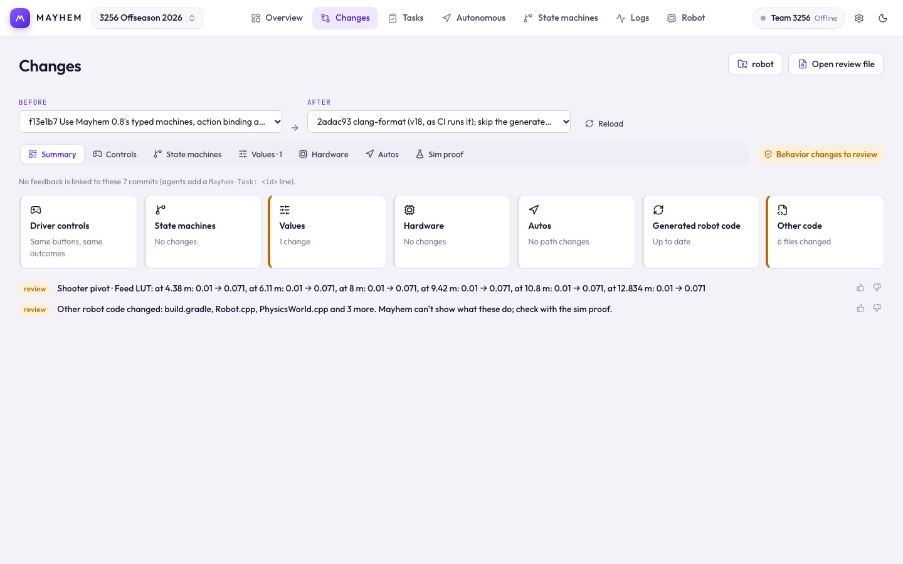

# Changes

Changes shows what a code change does to the robot, read straight from the code, so you can review agent-written (or anyone's) code by behavior instead of by diff.



## Branches to review

In the desktop app, click **Choose robot code folder** and pick the robot repository. The list on the left is the review queue, read from git:

- **To review**: every branch that isn't in `main` yet and was touched in the last three weeks. Each shows its newest commit, who made it, its risk, and whether a sim proof was run on it. Click one to review it: Mayhem compares the branch with the commit where it left `main`, so `main`'s own later commits don't show up as its changes. The **Changes** tab counts these.
- **Merged**: branches `main` already has, whether merged, rebased or squashed, with how far each has got (in main, on the robot, in a log).
- **Older or set aside**: stale branches, and ones you put away with the eye button. A branch you set aside comes back when it gets a new commit.

Mayhem looks for new commits when its window comes to the front; the arrows button looks now.

## Compare any two versions

**Before** and **After** follow the branch you pick, and can be set by hand:

- **This computer (not committed)**: your working copy, with how many files are edited.
- **Last commit** on the current branch.
- Any branch, branch on GitHub, tag or recent commit.

With nothing edited on this computer, Changes starts on `main` → the last commit of your branch: what the branch changes against the known-good version. Your choice is kept while the app is open.

**Reload** re-reads the code. In the browser, use **Open review file** with a file made by:

```sh
node scripts/mayhem.mjs review <robot repo> [before] [after] --json > review.json
```

The chip next to the tabs gives the overall risk. Red means a safety change.

## Summary

- **Where it is.** For a branch: its commits, whether it is in `main`, whether the robot runs it (as of the last **Check robot**), and the newest log recorded on it. All four are read from git, the robot and the logs.
- **Sim proof.** The run recorded on exactly this commit: how many scenarios, which failed or behave differently, who ran it and when. It is written by whatever ran the simulation (an agent's `run_scenarios`, or this app), not typed in. With none recorded, **Run sim proof** runs it and keeps the result on the commit. A run made against a different version says so.
- **Area cards.** Driver controls, state machines, values, hardware, autos, generated robot code and other code, each colored by its riskiest change. Click one to open its tab.
- **Other code.** Mayhem reads controls, state machines, values, hardware and autos. Any other file that ends up on the robot (logic in `.cpp` files, vendored libraries, deploy files) is only compared: the card counts the files that changed and the finding names them. Such a change is never reported as "no behavior changes"; the sim proof is how you check it. A team scenario that was removed, or that checks less than before, is called out the same way.
- **Findings.** Every change, marked **safety**, **review** or **ok**.
- **Commits.** The commits between the two versions.

## Tabs

| Tab | What it shows |
| --- | --- |
| **Controls** | Each driver input and what it does, before and after. Team rule: the same inputs must give the same outcomes, so any change here is called out. Comes from machines that list `operator` inputs in `tools/mayhem/machines.json`. |
| **State machines** | Added, removed and changed states and transitions. |
| **Values** | Changed constants: limits, gains, ratios. Safety kinds are marked red. |
| **Hardware** | A top-view map of the robot's devices with changed ones highlighted, and a table of CAN IDs and motor configuration. |
| **Autos** | Before/after paths, colored by speed, with time and distance differences. |
| **Sim proof** | Runs the robot code in simulation, before and after. See below. |

### Editing values and hardware

With **After** set to **This computer**, click the pencil on a value or device field to change it. Only that literal in the C++ source changes. The edit shows up as a change right away.

## Sim proof

**Run sim proof** builds both versions and runs every auto, presses every driver button, and runs your team scenarios from `tools/mayhem/scenarios.json`. The first run takes about a minute per version; repeats are cached.

Results are grouped into **Autos**, **Buttons** and **Team scenarios**, each marked pass, fail or different. Open one to replay it:

- **Field** or **3D** view (3D uses the team's CAD robot), **Side by side** or **Overlay**.
- Button results show lanes: shaded where the button is down, gray when idle.
- **Record clip** makes a video you can download. It's kept only while the replay is open.

A team scenario looks like this; [Sim proof scenarios](/robot-code/scenarios) lists every step and expectation:

```json
{
  "scenarios": [
    {
      "name": "Hold A shoots",
      "steps": ["teleop", "wait 0.5", "hold A 2"],
      "expect": ["Shooter mode is SHOOTING by 1.5 s"]
    }
  ]
}
```

If the sim proof says the generated code is out of date, run `tools/mayhem/export.sh` in the robot repo.
