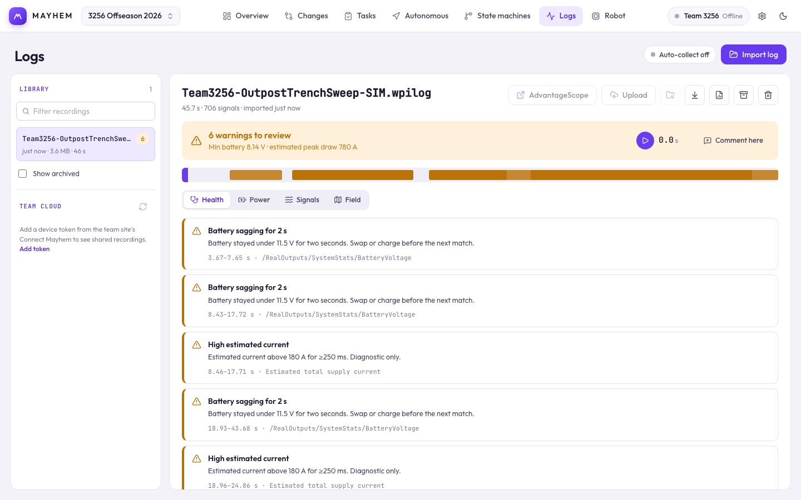

# Logs

Every recording is checked for red flags and power problems as soon as it arrives.

## The library

Import a `.wpilog` with the upload button, or let [log collection](/suite/robot#log-collection) bring them in. Recordings are stored on this computer. Filter the list by name; right-click a recording to open its report, open it in AdvantageScope, export the original, copy its name or path, archive it, or delete it.

**Team cloud** (desktop) lists recordings your teammates uploaded to the team site. Download one into your library with its cloud button. It needs a device token; **Add token** takes you to [Team upload](/suite/robot#team-upload).

Supported: WPILOG 1.0 scalars, numeric and boolean arrays, and common WPILib structs. Unknown types are reported, not dropped silently. Limit: 250 MB and two million samples per file.

## The report

The header has the verdict, findings linked to their times, and buttons to export the original or the report, open it in AdvantageScope, archive or delete. Click a finding to move the shared cursor there. **Comment here** turns the current moment into feedback for [Tasks](/suite/tasks).

| Tab | Use |
| --- | --- |
| **Health** | Findings, plus coverage and limits: which signals the findings could and couldn't use. |
| **Power** | Lowest battery, the voltage graph against the 6.8 V brownout line, energy, and the biggest current draws. Estimated currents are labeled. |
| **Signals** | Search channels and plot them at the shared cursor. |
| **Field** | Replay recognized pose data at the same cursor. |

### Signal mapping

Mayhem finds voltage and current signals by name. If it guesses wrong, set them under **Power → Signal mapping**, one per device, or open **Agent / custom signal mapping**: **Download signal catalog**, have an agent write the mapping, paste it, and **Apply mapping**. **Reset to automatic detection** undoes it. Mappings are saved per recording and match the team site's Logs page.

Findings depend on which signals are in the log. Check each one against its evidence.
