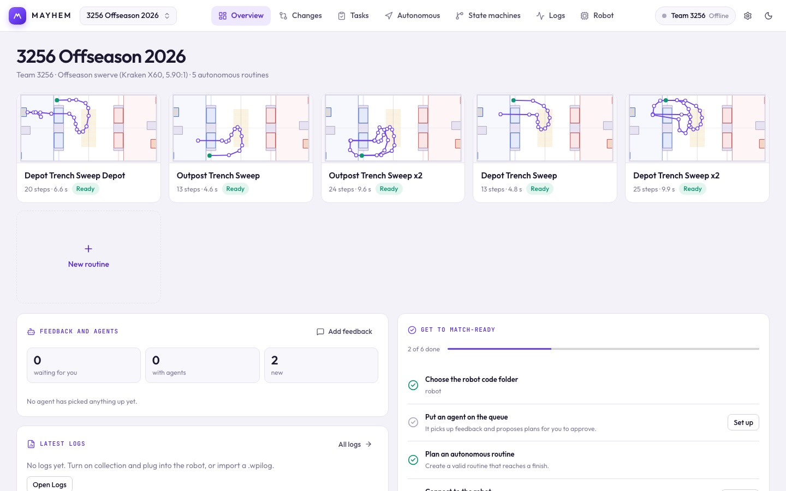

# The app at a glance

Mayhem opens to **Overview**. The top bar switches between the workspaces; the robot chip shows the connection, and the gear opens [Settings](/suite/projects#settings). The **Changes** tab shows a count when branches are waiting for your review.

| Workspace | What it's for |
| --- | --- |
| [Overview](#overview) | Changes waiting for review, routine thumbnails, latest logs, the match-ready checklist and the robot explainer. |
| [Changes](/suite/changes) | The branches waiting for review, and what each one does: driver controls, state machines, values, hardware, autos, and a sim proof. |
| [Autonomous](/suite/autonomous) | Place pose goals on the field, add actions and conditions, preview the routine. |
| [State machines](/suite/state-machines) | Routine and mechanism graphs, simulated, live over NT4 or replayed from a log. |
| [Logs](/suite/logs) | Import and analyze `.wpilog` recordings: health, power, signals and pose replay. |
| [Robot](/suite/robot) | What's on the robot now, every value in the code, specs and limits, connection and log collection. |

Most workspaces that read robot code (Changes, Robot → On the robot now and Values, the explainer) need the **desktop app** and a **robot code folder**. Choose the folder once from any of them; the rest use the same one. If the folder has a `robot.mayhem.json`, choosing it also opens that project, linked to the file, so Autonomous and State machines show this robot.

## Overview

- **Autonomous routines.** A thumbnail per routine with its run time, marked **Ready** or **Doesn't finish**. Click one to open it in Autonomous.
- **Changes to review.** The branches that aren't in `main` yet, each with its risk and whether a sim proof was run on it. Click one to review it in Changes. It also says how many merged changes are not on the robot yet.
- **Latest logs.** The newest recordings and whether their analysis is clean.
- **Get to match-ready.** Checks, each with a button that takes you to the fix:
  1. The robot code folder is chosen (desktop app).
  2. A routine runs without errors.
  3. The robot is connected.
  4. Log collection is on.
  5. The exported C++ matches the current project.

  Project errors and warnings are listed under the checklist.
- **How the robot works.** A clickable map of the robot read from its code. Click a part to see what it does, how the driver controls it, what it's doing right now (when connected) and its recent commits. Anyone can write or edit a part's plain-language description.

## Desktop vs. browser

| | Desktop app | Browser (`pnpm dev`) |
| --- | --- | --- |
| Autos, preview, state simulation, log analysis | Yes | Yes |
| Live file link to a project in the robot repo | Yes | Download snapshots only |
| Changes, Values, On the robot now | Yes | Changes opens saved review files |
| Log collection, AdvantageScope, deploy | Yes | No |

Install the desktop app from [Installation](/guide/installation).
