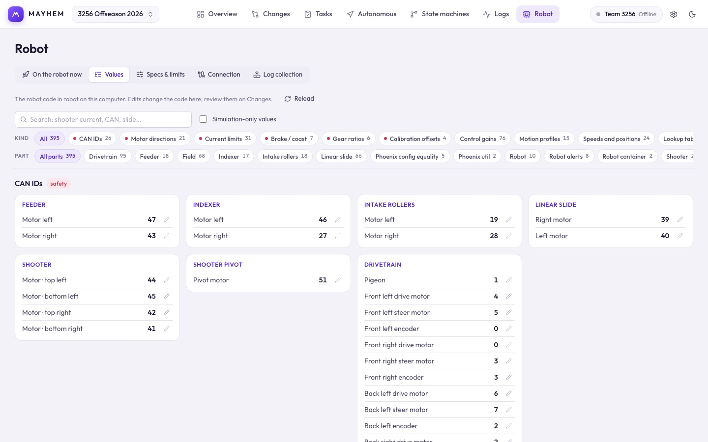

# Robot

The Robot workspace has five tabs.

## On the robot now

What code the robot is running (desktop app, robot connected). It refreshes when the robot connects, or click **Check robot**.

- The commit and branch, when and by whom it was built, and **same as main** when it matches.
- A warning if it was deployed with uncommitted changes, since nobody can rebuild exactly that version.
- If it differs from `main`: the commits on the robot but not on main, how many newer commits are on main, and two buttons:
  - **What's different from main** opens [Changes](/suite/changes) comparing them.
  - **Put main back on the robot** builds main and deploys it after you confirm. The robot must be connected and disabled. Nothing in the repository changes.
- The health of the newest log: red flags and any flickering signals.

`main` is the known-good version. The robot code has to record a [build stamp](/robot-code/logging#what-s-deployed) for this tab to work.

## Values

Every value in the robot code: CAN IDs, current limits, ratios, gains, inversions, brake/coast and more. Narrow it by **kind** or by **part**, or search. Safety-related kinds are marked. Click the pencil next to a value to change it; Mayhem rewrites just that literal in the C++ on this computer. Review the edit on [Changes](/suite/changes) before you commit.

## Specs & limits

The robot's length, width and drive limits that every auto is planned with, plus **Slow down before slower steps**. Lengths are in meters and angles in degrees here; exported code uses meters and radians.

The **typed inputs** (sensors, buttons, game state) that your routine conditions and state machines read are defined here too.

## Connection

Enter your team number, or an address override, and **Connect**. Values come in over read-only NT4; Mayhem never commands the robot. The browser version may not be allowed to connect to a robot from a hosted HTTPS page; use the desktop app.

**AdvantageScope:** set the application path if it isn't detected automatically. Logs then get an **Open in AdvantageScope** button.

## Log collection

### Automatic log collection (desktop)

| Source | Use |
| --- | --- |
| **Robot over Ethernet** | Pulls logs off the roboRIO over SFTP. Set the log folder on the robot (default `/home/lvuser/wpilogs`). |
| **Folder (simulation, USB)** | Watches a folder on this computer. |

List the files and **Download selected**, or turn on **Take every new log** (optionally only files whose names contain some text). It checks every 15 seconds while Mayhem is open and waits until a file stops growing. Collection keeps running whichever page you're on.

### Team upload

Enter the team website and a device upload token from the site's **Logs → Connect Mayhem**, then turn on **Upload new logs automatically**. New logs are queued and failed uploads retry. **Remember the token on this computer** keeps it across restarts; **Pause uploads** holds the queue. See [team log setup](https://github.com/ryanabraham1/Mayhem/blob/main/docs/TEAM_LOGS.md).
