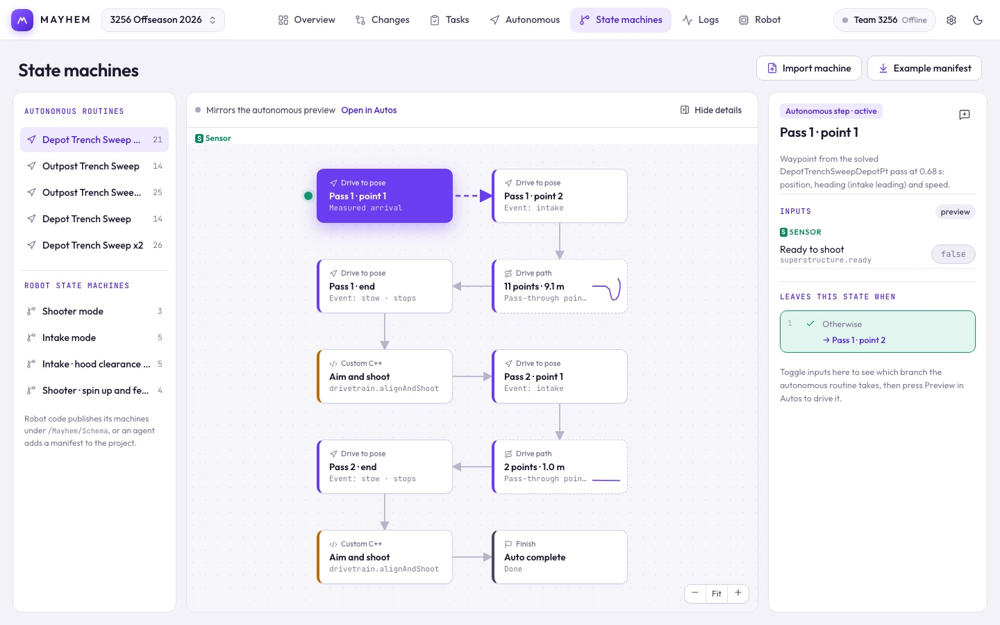

# State machines

See how states connect, which inputs drive each transition, and what the robot is doing right now.

Pick an autonomous routine or a robot state-machine manifest from the list. Then choose a data source:

| Source | What it shows |
| --- | --- |
| **Simulate** | Change the typed inputs and watch the machine step through its transitions. |
| **Live robot** | The current state from read-only NT4 values. Connect on [Robot → Connection](/suite/robot#connection) first. |
| **Log replay** | The states from a recording. Appears when a log is open in [Logs](/suite/logs). |

Click a state to see its guards and outgoing transitions. Transitions that can fire **from any state** are shown as chips rather than lines, so the graph stays readable. Priority-select machines are drawn as a ladder of questions checked from the top every loop, with the row deciding the current state highlighted.

Right-click a state for **Simulate from this state**, **Reset simulation**, **Edit step in Autos** (for routine steps), or copy its name or ID. Right-click a transition to copy its condition.

Mechanism machines come from `tools/mayhem/machines.json` in the robot repo; see [State machines in robot code](/robot-code/state-machines). For the live and replay views, the manifest has to match the channels your robot logs; see [Logging](/robot-code/logging).
