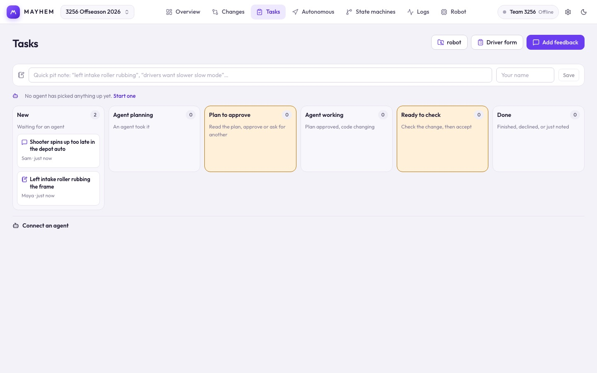

# Tasks

Feedback from the team becomes tasks for coding agents. You approve an agent's plan before it changes code, and check the change when it's done. Tasks live as one JSON file each in the robot repo's `tools/mayhem/review/` folder, so agents and teammates see them with the code. Choose the robot code folder first.

## Giving feedback

- **Add feedback**: thumbs up, thumbs down or a comment, with a short title and what should change.
- **Pit note**: the one-line box at the top. Type and press Save.
- **Driver form**: a quick post-match form (ratings, yes/no questions, what broke, what to change), attached to that match's log.
- **Right-click → Make this an agent task** almost anywhere in the app: an auto step, a state, a log moment, a Changes finding, a spot in a sim replay. The task records exactly what you pointed at.

Add your name so the agent and team know who to ask. In the browser, feedback downloads as a file to put in `tools/mayhem/review/`.

## The board

| Column | Meaning | You |
| --- | --- | --- |
| **New** | Waiting for an agent. | Can decline. |
| **Agent planning** | An agent took it. | **Back to New** takes it back if the agent stopped. |
| **Plan to approve** | The agent wrote a plan. | **Approve plan**, or write what should be different and **Ask for a different plan**. |
| **Agent working** | Plan approved, code changing. | **Back to New** takes it back if the agent stopped. |
| **Ready to check** | The change is done. | **See what changed on the robot** opens Changes for it; then **Accept the change**, or write what's wrong and **Not right, send back**. |
| **Done** | Accepted, declined or just noted. | Can reopen. |

Sending a plan or a change back needs a note: it is what the agent reads to fix it.

The Tasks tab badge counts plans and changes waiting for you, and the Overview lists them. Each card shows its kind, author, what it's pinned to, the agent, and the risk level of its latest change. Open a card for the full text, the plan, each change with its findings, and the history.

The line above the board names the agents on the queue and when each last did something. A task an agent has held for a day without an update is marked **no update for …**; take it back so another agent can pick it up.

### What gets accepted without you

Only two kinds of change skip **Ready to check**: one that changes only auto paths, every one of which still finishes in the preview, and one that touches nothing that reaches the robot (notes, a new scenario). Everything else waits for you, including any change to code Mayhem can't read. Those show as **Other robot code changed** with the file names; check them with the [sim proof](/suite/changes#sim-proof).

### The sim proof on a change

A card in **Ready to check** says whether a sim proof was run on that exact commit: **sim proof passed**, **differs**, **failed**, or **no sim proof**. Open the card to see the run: how many scenarios, which ones failed or behave differently, who ran it and when. That line is written by whatever ran the simulation (the agent's tool, or this app), never typed in by an agent.

- **Run sim proof** (when there is none) opens Changes on the task's versions and starts it. When it finishes, the result is kept on the task.
- **Watch them** opens the same comparison so you can replay the scenarios that changed.

A newer commit on the same task has no proof until one is run on it.

### After you accept

Accepting is not the end. A done task shows **Where it is now** as four steps, each read from git, the robot and the logs:

| Step | Reached when |
| --- | --- |
| **Accepted** | You accepted the change. |
| **In main** | Its pull request is merged (a squash merge counts). |
| **On the robot** | The code on the robot includes it, as of the last **Check robot**. |
| **In a log** | A collected log was recorded on code that includes it. The step names the log and its red flags; **Open log** opens it. |

The card's chip shows the furthest step, and the Overview says how many accepted changes are not merged or not on the robot yet.

## Connect an agent

Agents run in a terminal, and that is where you talk to them: an agent that needs to know something asks you there and waits. The app is for feedback, approving plans and checking changes.

Expand **Connect an agent** at the bottom of the page:

| Panel | What's there |
| --- | --- |
| **Put an agent on the queue** | A copyable prompt, with this robot's folder filled in, that tells any coding agent how to work the queue. Open the agent in a terminal in the robot code folder and paste it. For Claude Code, the same steps are a skill: copy `integrations/skills/mayhem-tasks` into the robot repo's `.claude/skills/` and run `/loop 10m /mayhem-tasks`. |
| **Share this project with an agent** | A copyable brief describing the project. |
| **Live file link** | **Save project file** links the project to a file in the robot repo; see [projects](/suite/projects#live-file-link-desktop). |
| **Connect over MCP** | Setup for the Mayhem MCP server. |
| **Command line** | `scripts/mayhem.mjs` commands. |
| **C++ library** | Export the routines as a C++ header for the robot. |
| **Project document** | The raw project JSON. |

Agents work tasks with the MCP tools `list_tasks`, `claim_task`, `propose_plan`, `report_progress` and `finish_task`, and can analyze logs, run scenarios and diff behavior with the others. See [Connect an agent](/agents/) and [How agents work tasks](/agents/tasks).

After an agent edits a routine, look at the field and graph, then preview it before running it on the robot.
